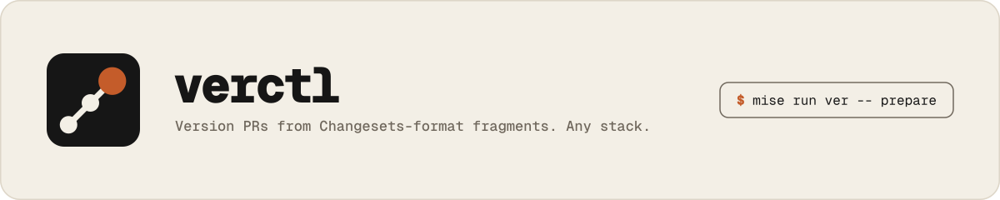

# verctl

<picture>
  <source media="(prefers-color-scheme: dark)" srcset="docs/banner-dark.svg">
  
</picture>

It reads `.changeset/*.md`, bumps declared version files, writes changelogs, and opens or updates one Version PR.

It is not `@changesets/cli`, not Knope, and not a forkctl verb.

```sh
mise run ver status
mise run ver check
mise run ver version
mise run ver version --pr
mise run ver release
```

## Setup

```toml
min_version = "2026.7.7"

[settings]
experimental = true
lockfile = true

[task_config]
includes = [
  "git::https://github.com/victor-software-house/verctl.git//tasks/ver?ref=<tag>",
]
```

```sh
mise run ver status
mise run ver check
mise run ver release --dry-run
```

## Output

Every command returns one typed report.  
Pretty, `--color never`, and `--format json` render the same data.  
JSON and human errors share that report contract; JSON errors use stdout, while human errors use stderr.  
`--quiet` suppresses only successful human output.  
JSON is never coloured, whatever `CLICOLOR_FORCE` or `FORCE_COLOR` say, and a parse error under `--format json` is a JSON error even when the bad argument comes first.

## Fragments

Same file shape as Changesets.  
YAML fence.  
Quoted or unquoted keys.

```md
---
forkctl: patch
"@scope/pkg": patch
---

Restore mise.toml when later patches unapply.
```

Allowed bumps: `major`, `minor`, `patch`, `patch!`, `none`.  
`patch!` is a patch that breaks the API on purpose: `verctl semver` skips the package for that release, and the changelog lists the entry under `### Breaking`.

An optional `verctl:group` key, `added`, `changed`, or `fixed`, files the entry under that heading.  
A section where no fragment names a group stays a flat list.  
Once one does, the section gets `### Added`, `### Changed`, and `### Fixed` headings, and an ungrouped fragment goes under `### Changed`.

A new package starts at `0.0.0`, and its first fragment is a `patch`, so its first release is `0.0.1`.  
Moving to `0.1.0` or `1.0.0` is a separate operator decision.  
`version` and `check` refuse a `minor` or `major` fragment on a package at `0.0.0`, including its pre-releases and builds.  
To open at `0.1.0` on purpose, set `first_minor: true` on the package in `.ctl/ver.yaml`.

`release` and `status` leave a package at `0.0.0` out, so a repo can adopt the release workflow before its first release.

## Changelog

Rendered with [minijinja](https://crates.io/crates/minijinja) 2.x from these defaults (override either path):

- [`templates/changelog.jinja`](templates/changelog.jinja)
- [`templates/dependency-changelog.jinja`](templates/dependency-changelog.jinja)

Default release line:

```text
PR                - Summary ([#12](https://github.com/org/repo/pull/12)).
Outside + PR      - Summary ([#12](https://github.com/org/repo/pull/12) by [@ext](https://github.com/ext)).
Commit only       - Summary ([`96fb0bc`](https://github.com/org/repo/commit/96fb0bc)).
No link           - Summary.
```

An entry ends with a single period.  
A summary that already ends with one loses it before the reference: `Summary.` with a pull request renders `- Summary ([#12](…)).`.

No extra thanks line.  
If a PR exists, the SHA is omitted.

The pull request is the trailing `(#N)` in the subject of the commit that added the fragment.  
GitHub's squash merge writes that `(#N)`.  
Without one, the entry links the commit.

Release notes credit no maintainer: list maintainers and the Apps that open pull requests in `changelog.internal_authors`.  
With a token, a byline needs a login outside that list, a person rather than a bot, and a pull request from a fork.

## Version files

`verctl version` applies fragment bumps through **drivers**.  
Local writes are the default.  
`version --pr` is the Version PR, the Action happy path; it uses `GITHUB_TOKEN` instead of the `gh` account.  
`version --dry-run` / `--preview` prints the plan and writes nothing.  
`version --pr --preview` also shows consumed fragments and open vs update.

Cargo, npm, `pyproject.toml`, `go.mod`, and `VERSION` are stock drivers, which share one code path with declared drivers.  
A `go.mod` keeps its version as `// vX.Y.Z` on its `module` line.  
The version is the only content of a `VERSION` file, and a missing one reads as `0.0.0` until `version` writes it.  
`marker: true` versions any file on its one `# version: X.Y.Z` line.  
Each `pyproject.toml` package names its `publisher`, or `none`: verctl has no stock Python publisher.

A repo's declarations live in one file, `.ctl/ver.yaml`.  
`.ctl/` is the directory every ctl CLI shares, so a repo root gains one entry however many of them it uses.

```yaml
drivers:
  cargo:
    format: toml
    keys: [workspace.package.version, package.version]
    # after is optional. If omitted, verctl looks at lockfiles /
    # packageManager (bun, pnpm, yarn, npm), Cargo.lock, and uv.lock.

  npm:
    format: json
    keys: [version]
    # after: mise run install           # overrides detection

packages:
  - name: verctl
    path: Cargo.toml
    # driver: cargo   # inferred from the file name

  - name: templates
    path: VERSION
    # driver: version  # inferred; releases on GitHub only

  - name: other
    path: release.txt
    read: ver-read-version              # mise run ver-read-version
    write: [printenv, VERCTL_VERSION]
```

A string is a **mise task**, and a list is execvp (no shell).  
Stdin is the file.  
Write drivers also get `VERCTL_VERSION`.  
Stdout is the version (read) or the new file (write).

`version` runs `after` once the versions are written.  
A detected lockfile refresh runs beside its lockfile.  
A declared `after` runs where verctl runs, split on spaces and without a shell.  
The report's `after` lists each command it ran.

`0.x` rejects a `major` fragment.

## Runners

Which machines run the work is configuration.  
A **machine** is declared once under `runners`; the jobs that run on it name it.

```yaml
# One machine. `labels` is how GitHub finds it — every label at once, so this
# is a single machine carrying three labels, not three machines.
runners:
  big:
    labels: [self-hosted, linux, x64]

# One validation job per entry. Naming two machines gives two checks,
# `verify (big)` and `verify (ns)`. Omit `ci` for one `verify` on ubuntu-latest.
ci:
  verify:
    runners: [big]

# One build target per entry: the name is the job, the tarball, and the
# platform. One tarball is one machine, so `runner` is not a list.
assets:
  darwin-arm64: {}
  linux-x64:
    runner: big
```

| section | one entry is | its name is | with no `runners` / `runner` |
|:--|:--|:--|:--|
| `runners` | one machine | how jobs refer to it | — |
| `ci` | a job that validates a PR or a push | the check name | `ubuntu-latest` |
| `assets` | a release build job and its tarball | the check name, the `release asset` argument, part of the filename | the built-in record for that name |

Two sections take runners and no others, because of what config is for here:

> **verctl decides how many jobs there are. Your workflow file decides where a
> fixed job runs.**

To declare N jobs, a static workflow has to hold N, and only the repo's config holds it.  
That fan-out is what `ci` and `assets` buy; the machine rides along on it.  
No other job's machine is a config key.  
The release workflow's `plan`, `publish`, `docs`, and `propose` jobs run on its `runner` input, a JSON label list that defaults to `["ubuntu-latest"]`.

A CI `plan` job's `runs-on` is one literal in a workflow you own and already copied from `examples/`:

```yaml
  plan:
    runs-on: [self-hosted, linux, x64]   # yours to edit; no declaration needed
```

So a repo with no hosted runners at all is already served: edit those literals and declare `ci` / `assets`.  
`plan` could not read its machine from config anyway: `runs-on` resolves before the job exists, and `plan` is the job that reads the declarations.

Names sort alphabetically, not in file order, so a `verify` job written above an `audit` job still plans `audit` first.  
Checks are independent, so the order is display only.

Only `labels` reaches GitHub.  
A runner **name** is a name in the file.  
It resolves against `runners`, or fails there and lists what is declared.  
So a label can never pass itself off as a machine, and verctl never invents a label.

A label GitHub does not know queues the way any wrong label queues.  
verctl has no record of which machines carry which labels, so it passes them through.

Built-in target records, so a public repo needs no config to stay on free hosted minutes:

| name | labels | `os` | `arch` | `triple` |
|:--|:--|:--|:--|:--|
| `darwin-arm64` | `["macos-latest"]` | `darwin` | `arm64` | `aarch64-apple-darwin` |
| `linux-x64` | `["ubuntu-latest"]` | `linux` | `x64` | `x86_64-unknown-linux-gnu` |

Each field is a default the repo overrides one at a time: naming a `runner` moves the machine and leaves the platform alone.  
verctl has no record for a name outside that set, so the entry must describe the whole platform.  
`runner`, `os`, `arch`, and `triple` are all required there.  
A partial record is an error, which stops a build against an empty target triple.

`os: darwin` renders as `macos` in the filename; that is the only rename.  
`triple` stays its own field because the machine and what it builds need not match: an x64 linux runner can build `aarch64-unknown-linux-gnu`.

`ci` is exactly as trusted as `.github/workflows/ci.yml`.  
For a `pull_request` event both come from the pull request's own tree.  
So a fork PR that can declare a label could equally have written that label into the workflow file.

Neither is a reason to expose a self-hosted runner group to a public repository.  
Keep `allows_public_repositories=false` there and keep fork-PR approval on.  
In a repo where that is not true, read declared labels as untrusted input.

`verctl ci` and `verctl status` print what resolved, so a default is visible output rather than an assumption.  
With `--github-output`, both also write a matrix: GitHub needs `runs-on` before a job exists, so a small `plan` job emits the labels and the real jobs consume them ([`examples/workflows/ci.yml`](examples/workflows/ci.yml)).

## Asset contents

An `assets` tarball holds the one `binary`, default `target/{triple}/release/{bin}`, packed as `bin`.  
A release that ships more, such as a daemon beside its client, a service unit, or a licence, lists it instead:

```yaml
assets:
  dir: target/{triple}/release
  files: [demo, demod, "demod@.service", LICENSE]
  linux-x64: {}
```

`verctl release asset <id>` runs the build, checks that each listed path exists under `dir`, then packs `tar czf <asset> -C <dir> <files>`.  
`dir` and `files` take the placeholders `binary` takes, come together, and replace `binary`, which may not be set beside them.  
A file the build does not write, such as a licence, is copied into `dir` by the build command.

A target that ships other files, such as a tool built only on Linux, lists its own `files`.  
They replace the shared list for that target alone:

```yaml
assets:
  dir: target/{triple}/release
  files: [demo, demo-bench]
  darwin-arm64:
    files: [demo]
  linux-x64: {}
```

A target without `files` packs the shared list.  
A target's `files` needs `dir`, may not be empty, and may not be set beside `binary`.  
When every target lists its own, the shared `files` may be left out.

## Vendored assets

A repository can build someone else's library from a pinned upstream release.  
It can then publish the result as Release assets, so mise installs it as a `github:` tool.  
The set carries the upstream version; fragments never bump it and `release` never reads it.  
A config that vendors may declare no packages.

```yaml
vendored:
  libexample:
    version: 1.4.0
    build: [mise, run, "libexample:build", "{id}"]
    dir: build/libexample/{id}
    files: [lib/libexample.a, include, LICENSE]
    notes: vendor/libexample.md
    targets:
      linux-x64:
        runner: ns
      macos-arm64:
        runner: macos
```

| key | means | when omitted |
|:--|:--|:--|
| `version` | the upstream version, `{version}` | required |
| `tag` | the Release tag, with `{name}` and `{version}` | `{name}-{version}` |
| `archive` | the archive name, with `{name}`, `{version}`, and `{id}` | `{name}-{version}-{id}.tar.gz` |
| `build` | an argv run once per target, with the same placeholders | nothing runs; an earlier step built |
| `dir` | the directory the files are packed from | required |
| `files` | paths under `dir`, each kept at its place; a directory is packed whole | required |
| `notes` | a file whose text is the Release body | an empty body |
| `targets` | one entry per platform, `{id}`, each naming one `runner` | required |

`verctl status --vendored libexample --github-output "$GITHUB_OUTPUT"` plans the set and writes the same `has_assets`, `tag`, and `matrix` outputs as the packages' assets.  
In the build job:

```yaml
      - env:
          GITHUB_TOKEN: ${{ github.token }}
          VERCTL_VENDORED: libexample
          VERCTL_TARGET: ${{ matrix.id }}
        run: mise run ver release asset
```

`release asset` builds the archive, then creates the Release at `HEAD` when it is missing, never marked latest, and attaches the archive and `<archive>.sha256`.  
The digest in that file is the one GitHub reports for the stored archive.  
So a rerun whose build output differs in any byte still publishes a checksum that matches.

An asset the Release already holds is reported as `already`.  
To replace an archive, delete it and its `.sha256` together.  
`--dry-run` builds the archive and uploads nothing.

## Release workflow

A repository releases through one thin caller of verctl's reusable workflow ([`examples/workflows/release.yml`](examples/workflows/release.yml)).  
It triggers on push to the default branch and on `workflow_dispatch`, and runs one flow:

1. `plan` runs `verctl status --github-output`, which lists every version commit whose release is incomplete.
2. `publish` runs `verctl release` at each, oldest first.
3. `assets` runs `verctl release asset` for the tarballs each Release lacks.
4. `docs` waits for docs.rs to build each released crate.
5. `propose` opens or updates the Version PR.

Every job is safe to rerun.  
A run with nothing pending reports `nothing to release`.  
Every input is optional and defaults to verctl's, so a caller passes only what differs.  
Steps set `env:` and run `mise run ver <verb>`, so the caller serves the `ver` task and pins verctl in its mise config.  
`plan` alone checks that the pinned verctl is 0.8.0 or later, and checks each `mise-ignored-config-paths` entry.

Every job requests `id-token: write`, so the caller grants it.  
The publish job uses it for crates.io trusted publishing.  
Every job uses it to download tools through the release mirror of `victor-software-house/actions/mise`.  
A job without the grant downloads from GitHub and logs a notice.

A registry token stored in a GitHub environment that admits only the default branch is out of reach of every other branch.  
Pass `environment: <name>`, and map the token by its stored name: `registry-token: ${{ secrets.CARGO_REGISTRY_TOKEN }}`.  
Only the `publish` job runs in the environment, and it receives the environment's value.

The workflow reads no secret by a computed name, so a caller never passes `secrets: inherit`.  
The App secrets stay in the same `secrets:` map.  
`registry-token-env` names only the variable the publisher reads the token from (`CARGO_REGISTRY_TOKEN` by default).  
A crate's first publish maps the token and turns `crates-io-trusted-publishing` off for that one release, because the workflow refuses both.

The publish step sets `VERCTL_REGISTRY_TOKEN` from the secret and `VERCTL_TRUSTED_PUBLISHING_TOKEN` from trusted publishing.  
`verctl release` fails when both are set.  
It gives the token to each publisher and its registry `query` under `--registry-token-env` (`VERCTL_REGISTRY_TOKEN_ENV`).  
No other command it starts gets either variable.

To migrate from `version-pr.yml` and `publish.yml`, do it in one pull request:

1. Add the caller as `.github/workflows/release.yml`.
2. Delete both old workflows.
3. Close the open `version-packages` pull request and delete that branch.

The first push after the merge opens the Version PR from `verctl/release/<base>`.

Adopt the caller when no release is pending, or merge the adoption before the Version PR.  
Each release runs at its version commit, and an older version commit lacks the `ver` task the reusable workflow runs.  
A pending version commit that pins verctl older than 0.8.0 fails on the `release` verb, so move its pin with the workflow ref.

GitHub refuses a Release at a commit whose `.github/workflows` differs from the default branch unless the token holds `workflows: write`, which `GITHUB_TOKEN` cannot.  
So some packages get their tag and Release before their uploads, in the run that merged the Version PR.

These are the packages with no upload, and those whose uploads all have a registry check.  
A rerun after a failed upload finds the tag and Release.

A package with an unchecked upload is tagged after its upload, since its tag is the record that the upload ran.

## Actions

These replace `changesets/action`.  
They are **GitHub Actions**, with no GitHub App.  
The runner already has `git` and `GITHUB_TOKEN`.  
PRs are opened with octocrab.  
Commits are written with `gix`; the push runs `git push` with that token, passed through a credential helper and never on the command line or in a URL.  
There is no local token setup.

| Action | Role |
|:--|:--|
| [`actions/version-pr`](actions/version-pr/action.yml) | Open or update the Version PR |
| [`actions/publish`](actions/publish/action.yml) | Run after that PR merges |
| [`actions/asset`](actions/asset/action.yml) | Build and attach one native target |

For a hand-written workflow, use these actions; most repositories call the reusable workflow instead.

The Version PR comes from `verctl/release/<base>`, one per base branch.  
`check --versions` fails it when it changes anything the version step does not write from the merge-base.  
That covers a source file, a manifest key no pin names, and a lockfile entry other than a workspace version the plan moves.

Any other pull request fails when it adds a CHANGELOG section for a version.  
It also fails when it changes whether a package publishes without a fragment that bumps it.  
verctl never merges the Version PR or enables auto-merge on it: a release starts only when a person merges it.

Mise owns tools.  
Publish uses the `registry-token` secret and the workflow's `GITHUB_TOKEN`, with no personal access token.  
The publisher reads the token as `CARGO_REGISTRY_TOKEN` for crates.io.

A package with `publisher: none` is released on GitHub only: `release` creates its tag and Release, and `release asset` its tarballs, with no registry upload.  
A manifest that opts out of publishing needs no `publisher: none`: a `Cargo.toml` with `publish = false` or `[]`, or a `package.json` with `"private": true`.

`publish` on a package holds options of its publisher.  
`publish: {verify: false}` makes cargo upload with `--no-verify`, for a crate CI already packs on every commit to the default branch, and keeps the crates.io check.

## Operator documents

Clap remains the command grammar.  
ctl-core `Surface` renders the shared version, mounted invocation/no-`--`, and visible command-inventory fragments.  
Verctl's Jinja templates retain domain prose, and `operator_docs` byte-compares their renders with `skills/verctl/SKILL.md` and `src/instructions.md`.

## License

MIT.
