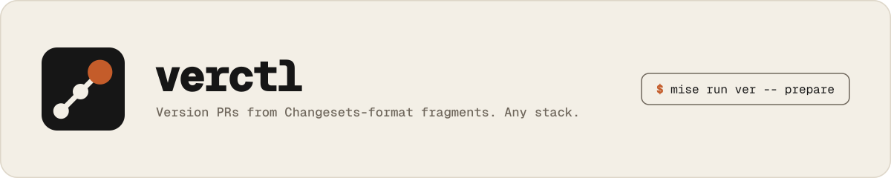

# verctl

<picture>
  <source media="(prefers-color-scheme: dark)" srcset="docs/banner-dark.svg">
  
</picture>

It reads `.changeset/*.md`, bumps declared version files, writes
changelogs, and opens or updates one prepare-release PR.

It is not `@changesets/cli`, not Knope, and not a forkctl verb.

```sh
mise run ver status
mise run ver check
mise run ver prepare
mise run ver prepare --pr
mise run ver publish
```

## Setup

```toml
min_version = "2026.7.7"

[settings]
experimental = true
lockfile = true

[task_config]
includes = [
  "git::https://github.com/victor-software-house/verctl.git//tasks/ver?ref=<tag>",
]
```

```sh
mise run ver status
mise run ver check
mise run ver publish --dry-run
```

Until a GitHub Release exists, build from this repo:

```sh
cargo run -- status
```

## Output

Every command returns one typed report. Pretty, `--color never`, and
`--format json` render the same data. JSON and human errors share that report
contract; JSON errors use stdout, while human errors use stderr. `--quiet`
suppresses only successful human output. JSON is never coloured, whatever
`CLICOLOR_FORCE` or `FORCE_COLOR` say, and a parse error under
`--format json` is a JSON error even when the bad argument comes first.

## Fragments

Same file shape as Changesets. YAML fence. Quoted or unquoted keys.

```md
---
forkctl: patch
"@scope/pkg": patch
---

Restore mise.toml when later patches unapply.
```

Allowed bumps: `major`, `minor`, `patch`, `none`.

An optional `verctl:group` key, `added`, `changed`, or `fixed`, files the
entry under that heading. A section where no fragment names a group stays a
flat list; once one does, the section gets `### Added`, `### Changed`, and
`### Fixed` headings, and an ungrouped fragment goes under `### Changed`.

A new package starts at `0.0.0`, and its first fragment is a `patch`, so its
first release is `0.0.1`. Moving to `0.1.0` or `1.0.0` is a separate operator
decision. `prepare` and `check` refuse a `minor` or `major` fragment on a
package at `0.0.0`, including its pre-releases and builds; to open at
`0.1.0` on purpose, set `first_minor: true` on the package in `.ctl/ver.yaml`.
`publish` and `publish --plan` leave a package at `0.0.0` out, so a repo can
adopt the release workflow before its first release.

## Changelog

Rendered with [minijinja](https://crates.io/crates/minijinja) 2.x from
these defaults (override either path):

- [`templates/changelog.jinja`](templates/changelog.jinja)
- [`templates/dependency-changelog.jinja`](templates/dependency-changelog.jinja)

Default release line:

```text
PR                - Summary ([#12](https://github.com/org/repo/pull/12)).
Outside + PR      - Summary ([#12](https://github.com/org/repo/pull/12) by [@ext](https://github.com/ext)).
Commit only       - Summary ([`96fb0bc`](https://github.com/org/repo/commit/96fb0bc)).
No link           - Summary.
```

An entry ends with a single period: a summary that already ends with one
loses it before the reference, so `Summary.` with a pull request renders
`- Summary ([#12](…)).`.

No extra thanks line. If a PR exists, the SHA is omitted.

The pull request is the trailing `(#N)` in the subject of the commit
that added the fragment, which GitHub's squash merge writes; without one
the entry links that commit. Release notes credit no maintainer: list
maintainers and the Apps that open pull requests in
`changelog.internal_authors`. With a token, a byline needs a login
outside that list, a person rather than a bot, and a pull request from a
fork.

## Version files

`verctl prepare` applies fragment bumps through **drivers**.
Local writes are the default. `prepare --pr` is the Version PR
(Action happy path; the token is `GITHUB_TOKEN`, not the `gh` account).
`prepare --dry-run` / `--preview` prints the plan and writes nothing.
`prepare --pr --preview` also shows consumed fragments and open vs update.
Cargo and npm are stock drivers, not a separate code path.

A repo's declarations live in one file, `.ctl/ver.yaml`. `.ctl/` is the
directory every ctl CLI shares, so a repo root gains one entry however many of
them it uses.

```yaml
drivers:
  cargo:
    format: toml
    keys: [workspace.package.version, package.version]
    # after is optional. If omitted, verctl looks at lockfiles /
    # packageManager (bun, pnpm, yarn, npm) and Cargo.lock.

  npm:
    format: json
    keys: [version]
    # after: mise run install           # overrides detection

packages:
  - name: verctl
    path: Cargo.toml
    # driver: cargo   # inferred from the file name

  - name: other
    path: VERSION
    read: ver-read-version              # mise run ver-read-version
    write: [printenv, VERCTL_VERSION]
```

A string is a **mise task**. A list is execvp (no shell).
Stdin is the file. Write drivers also get `VERCTL_VERSION`.
Stdout is the version (read) or the new file (write).
`after` is printed, not run.

`0.x` rejects a `major` fragment.

## Runners

Which machines run the work is configuration. A **machine** is declared once
under `runners`; the jobs that run on it name it.

```yaml
# One machine. `labels` is how GitHub finds it — every label at once, so this
# is a single machine carrying three labels, not three machines.
runners:
  big:
    labels: [self-hosted, linux, x64]

# One validation job per entry. Naming two machines gives two checks,
# `verify (big)` and `verify (ns)`. Omit `ci` for one `verify` on ubuntu-latest.
ci:
  verify:
    runners: [big]

# One build target per entry: the name is the job, the tarball, and the
# platform. One tarball is one machine, so `runner` is not a list.
assets:
  darwin-arm64: {}
  linux-x64:
    runner: big
```

| section | one entry is | its name is | with no `runners` / `runner` |
|:--|:--|:--|:--|
| `runners` | one machine | how jobs refer to it | — |
| `ci` | a PR / push validation job | the check name | `ubuntu-latest` |
| `assets` | a release build job and its tarball | the check name, the `--build` argument, part of the filename | the built-in record for that name |

Two sections take runners and no others, because of what config is for here:

> **verctl decides how many jobs there are. Your workflow file decides where a
> fixed job runs.**

A static YAML file cannot declare N jobs without knowing N, and only the repo
knows N. That fan-out is what `ci` and `assets` buy; the machine rides along
on it. Every other job verctl ships — `plan`, `crate`, `pin`, `prepare` — is
always exactly one job, so nothing decides its count and nothing needs to
configure it. Its `runs-on` is one literal in a workflow you own and already
copied from `examples/`:

```yaml
  plan:
    runs-on: [self-hosted, linux, x64]   # yours to edit; no declaration needed
```

So a repo with no hosted runners at all is already served: edit those literals
and declare `ci` / `assets`. `plan` could not read its machine from config
anyway — `runs-on` resolves before the job exists, and `plan` is the job that
reads the declarations.

Names sort alphabetically, not in file order, so a `verify` job written above
an `audit` job still plans `audit` first. Checks are independent, so the order is
display only.

Only `labels` reaches GitHub. A runner **name** is a name in the file: it
resolves against `runners` or fails there, listing what is declared, so a
label can never pass itself off as a machine and verctl never invents a label.
A label GitHub does not know queues the way any wrong label queues — verctl
cannot tell which machines carry which labels, so it passes them through.

Built-in target records, so a public repo needs no config to stay on free
hosted minutes:

| name | labels | `os` | `arch` | `triple` |
|:--|:--|:--|:--|:--|
| `darwin-arm64` | `["macos-latest"]` | `darwin` | `arm64` | `aarch64-apple-darwin` |
| `linux-x64` | `["ubuntu-latest"]` | `linux` | `x64` | `x86_64-unknown-linux-gnu` |

Each field is a default the repo overrides one at a time: naming a `runner`
moves the machine and leaves the platform alone. A name outside that set
describes a platform verctl knows nothing about, so it must describe all of it
— `runner`, `os`, `arch`, and `triple` are all required, and a partial record
is an error rather than a build against an empty target triple. `os: darwin`
renders as `macos` in the filename; that is the only rename. `triple` stays
its own field because the machine and what it builds need not match: an x64
linux runner can build `aarch64-unknown-linux-gnu`.

`ci` is exactly as trusted as `.github/workflows/ci.yml`: for a
`pull_request` event both come from the pull request's own tree, so a fork PR
that can declare a label could equally have written that label into the
workflow file. Neither is a reason to expose a self-hosted runner group to a
public repository — keep `allows_public_repositories=false` there and keep
fork-PR approval on, and read declared labels as untrusted input in a repo
where that is not true.

`verctl ci` and `verctl assets` print what resolved, so a default is visible
output rather than an assumption. Both also write a matrix for
`$GITHUB_OUTPUT`: GitHub needs `runs-on` before a job exists, so a small
`plan` job emits the labels and the real jobs consume them
([`examples/workflows/ci.yml`](examples/workflows/ci.yml)).

## Release workflow

A repository releases through one thin caller of verctl's reusable workflow
([`examples/workflows/release.yml`](examples/workflows/release.yml)). It
triggers on push to the default branch and on `workflow_dispatch`, and runs
one flow:

1. `plan` lists every version commit whose release is incomplete.
2. `publish` releases each, oldest first, at its own commit.
3. `assets` builds the tarballs each Release lacks.
4. `finalize` publishes each draft Release once its assets are uploaded.
5. `docs` waits for docs.rs to build each released crate.
6. `propose` opens or updates the Version PR.

Every job is safe to rerun. A run with nothing pending reports `nothing to
release`. Every input is optional and defaults to verctl's, so a caller passes
only what differs. Steps set `env:` and run `mise run ver <verb>`, so the
caller serves the `ver` task and pins verctl in its mise config.

To migrate from `version-pr.yml` and `publish.yml`, do it in one pull request:

1. Add the caller as `.github/workflows/release.yml`.
2. Delete both old workflows.
3. Close the open `version-packages` pull request and delete that branch.

The first push after the merge opens the Version PR from
`verctl/release/<base>`.

Adopt the caller when no release is pending, or merge the adoption
before the Version PR. Each release runs at its version commit, and an
older version commit lacks the `ver` task the reusable workflow runs.

GitHub refuses a Release at a commit whose `.github/workflows` differs
from the default branch unless the token holds `workflows: write`, which
`GITHUB_TOKEN` cannot. So a package whose uploads all have a registry
check, or that has no upload, gets its tag and Release before its
uploads, in the run that merged the Version PR, and a rerun after a
failed upload finds them. A package with an unchecked upload is tagged
after its upload, since its tag is the record that the upload ran.

### Release assets

A Release with declared assets stays a draft until every asset is
uploaded, so it works with GitHub immutable Releases, which take no asset
once published. Declared assets are each `assets` target's tarball and each
`assets.files` entry, a file the repository builds itself:

```yaml
assets:
  files: [build/App.pkg]
```

A repository that builds its own files runs, in its release job:

```sh
verctl publish                                    # tag, then a draft Release
verctl assets --upload --file build/App.pkg       # once per declared file
verctl publish                                    # publishes the draft
```

The second `publish` publishes the draft once every declared asset is
uploaded, and otherwise reports what the draft lacks. The reusable
workflow's `finalize` job does the same after the `assets` jobs.
`--skip-assets` publishes the Release at once.

## Actions

These replace `changesets/action`. They are **GitHub Actions, not a
GitHub App**. The runner already has `git` and `GITHUB_TOKEN`. PRs are
opened with octocrab. Commits are written with `gix`; the push runs
`git push` with that token, passed through a credential helper and
never on the command line or in a URL. There is no local token setup.

| Action | Role |
|:--|:--|
| [`actions/version-pr`](actions/version-pr/action.yml) | Open or update the Version PR |
| [`actions/publish`](actions/publish/action.yml) | Run after that PR merges |
| [`actions/asset`](actions/asset/action.yml) | Build and attach one native target to the draft Release |

For a hand-written workflow, use these actions; most repositories call the
reusable workflow instead.

The Version PR comes from `verctl/release/<base>`, one per base branch.
`actions/version-pr` takes `auto-merge: true` (`prepare --pr --auto-merge`)
to merge the Version PR once the base branch's required checks pass. It
needs a ruleset that requires a status check on that branch, and a GitHub
App token in `token`; verctl checks both before it writes anything.

Mise owns tools. Publish uses the registry's token secret (for crates.io,
`CARGO_REGISTRY_TOKEN`) and the workflow's `GITHUB_TOKEN`; no PAT.

A package with `publisher: none` is released on GitHub only: `publish`
creates its tag and Release, and `assets` its tarballs, with no registry
upload. Use it for private binaries, such as a Cargo package with
`publish = false`.

## Operator documents

Clap remains the command grammar. ctl-core `Surface` renders the shared version,
mounted invocation/no-`--`, and visible command-inventory fragments. Verctl's
Jinja templates retain domain prose, and `operator_docs` byte-compares their
renders with `skills/verctl/SKILL.md` and `src/instructions.md`.

## License

MIT.
